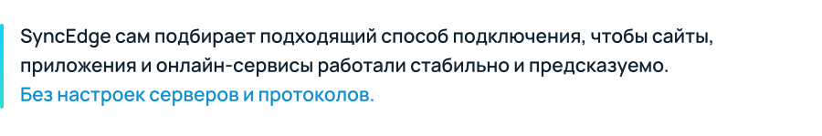

<picture>
  <source media="(prefers-color-scheme: dark)" srcset="assets/lead-dark.svg">
  
</picture>

  
  &nbsp;
  

 

### Почему SyncEdge

<table>
  <tr>
    <td width="50%" valign="top">
       
      <b>Стабильное соединение</b> 
      Распределённая инфраструктура выбирает подходящий маршрут для каждого подключения.
    </td>
    <td width="50%" valign="top">
       
      <b>Подключение за пару минут</b> 
      Готовая ссылка, QR-код и пошаговая инструкция в личном кабинете.
    </td>
  </tr>
  <tr>
    <td width="50%" valign="top">
       
      <b>Один аккаунт — все устройства</b> 
      Смартфон, планшет, компьютер и другие поддерживаемые устройства.
    </td>
    <td width="50%" valign="top">
       
      <b>Автоматический выбор</b> 
      Не нужно разбираться в серверах и протоколах — сервис предложит вариант сам.
    </td>
  </tr>
</table>

### Ссылки

- **Сайт и личный кабинет** — [sync-edge.net](https://sync-edge.net)
- **Статус сервиса** — [sync-edge.net/status](https://sync-edge.net/status)
- **Управление сервисом** — [@SyncEdgeBot](https://t.me/SyncEdgeBot) в Telegram
- **Поддержка** — [@SyncEdgeSupportBot](https://t.me/SyncEdgeSupportBot) или [support@sync-edge.net](mailto:support@sync-edge.net)

> [!IMPORTANT]
> Скачивайте приложения SyncEdge только с [sync-edge.net](https://sync-edge.net).
> О проблемах безопасности сообщайте по правилам из [SECURITY.md](https://github.com/SyncEdgeNetwork/.github/blob/main/SECURITY.md).
